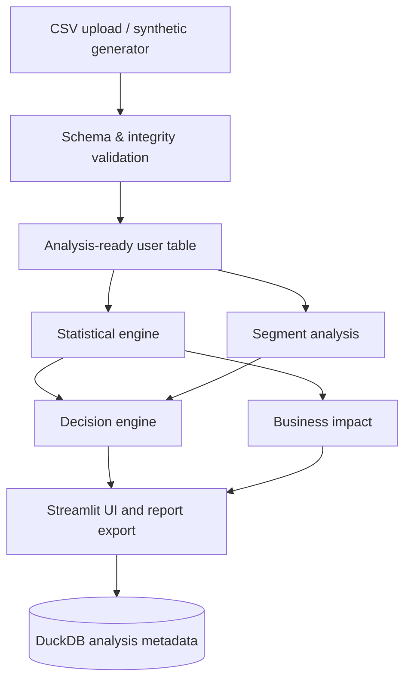

# Varianta — A/B Testing & Decision Intelligence

A portfolio-oriented Streamlit application for checkout experiments. It combines reproducible synthetic data, integrity checks, sample-size planning, statistical summaries, segmentation, impact projections, a transparent decision engine, JSON/CSV exports, and a local DuckDB analysis registry.

> **Important:** the built-in dataset is synthetic. Results are simulated and must never be represented as real company outcomes. This is a decision-support demo, not a release-authorization system.

## Features
- Synthetic user-level checkout experiment data with stable one-row-per-user assignment and fixed random seed.
- CSV upload with required-column validation.
- Integrity report for missing values, duplicate assignments, variant labels, timestamps, cross-variant assignment, outcome consistency, sample-ratio mismatch, and minimum arm size.
- Two-proportion z-test, Wilson/Newcombe-style interval for conversion difference, Welch t-test for revenue per eligible user.
- Two-proportion sample-size planning with target power.
- Segment conversion summaries with Benjamini–Hochberg adjusted p-values.
- Business impact projection, decision rules, JSON report and CSV exports.
- DuckDB metadata registry, 131 automated pytest cases, Docker, and GitHub Actions.

## Quick start (Windows PowerShell)
```powershell
py -3.11 -m venv .venv
.\.venv\Scripts\Activate.ps1
python -m pip install --upgrade pip
pip install -r requirements.txt
streamlit run app.py
```
Open the local URL Streamlit prints, typically `http://localhost:8501`.

## Quick start (macOS/Linux)
```bash
python3.11 -m venv .venv
source .venv/bin/activate
python -m pip install --upgrade pip
pip install -r requirements.txt
streamlit run app.py
```

## Run tests
```bash
pytest -q
```

The included suite currently contains **131 passing test cases** across deterministic data generation, schema checks, duplicate assignments, invalid timestamps, sample-size inputs, conversion metrics, edge cases, segmentation, business projections, decision outcomes, and report structure. This is a meaningful regression suite, not a mathematical proof of correctness; review the known limitations below.

## Docker
```bash
docker compose up --build
```

## CSV schema
Required columns: `user_id`, `variant` (`Control`/`Treatment`), `assignment_timestamp`, `event_timestamp`, `device_type`, `country`, `acquisition_channel`, `is_new_customer`, `checkout_started`, `purchase_completed`, `order_value`, `refund_indicator`, `checkout_error_indicator`, `page_load_time_ms`, `experiment_eligible`. A single row represents one randomized user. If your event-level export contains multiple rows per user, aggregate it to a documented user-level analysis table first.

## Statistical notes
- Primary outcome: purchase conversion per eligible randomized user.
- Test: two-sided two-proportion z-test.
- Confidence interval: Newcombe-style interval constructed from Wilson score intervals.
- Continuous revenue: revenue per eligible user includes zero for non-purchasers; Welch t-test is a simple baseline and may be sensitive to skew/outliers.
- Segment results are exploratory and p-values are BH-adjusted.
- Sample-size planning uses a normal-approximation power calculation for two independent proportions.
- Fixed-horizon inference assumes the planned analysis time was respected. Repeated significance checking requires a valid sequential design, which this version does not implement.
- A non-significant p-value does not establish equivalence or absence of harm.
- Guardrail charts and configurable non-inferiority tests are not fully implemented; review refund, error, and performance outcomes separately before acting.
- Business impact is a projection based on the observed effect and assumptions, not a forecast guarantee.

## Architecture


## Data dictionary
| Field | Definition |
|---|---|
| user_id | Stable randomized user identifier |
| experiment_id | Experiment key |
| variant | Control or Treatment assignment |
| assignment_timestamp | Time of random assignment |
| event_timestamp | Simulated outcome observation timestamp |
| device_type | Device category |
| country | Simulated country |
| acquisition_channel | Acquisition source |
| is_new_customer | New-customer flag |
| session_id | Session identifier |
| checkout_started | Whether checkout started |
| purchase_completed | User-level purchase outcome |
| order_value | Simulated order value; zero for non-purchasers |
| refund_indicator | Simulated refund flag |
| checkout_error_indicator | Simulated checkout error |
| page_load_time_ms | Simulated page-load latency |
| experiment_eligible | Eligibility flag |

## Example SQL
```sql
-- Compare assignment counts
SELECT variant, COUNT(*) AS users
FROM assignments
GROUP BY variant;

-- User-level conversion by arm
SELECT variant,
       AVG(CASE WHEN purchase_completed THEN 1.0 ELSE 0.0 END) AS conversion_rate,
       COUNT(*) AS eligible_users
FROM analysis_users
WHERE experiment_eligible = TRUE
GROUP BY variant;

-- Revenue per eligible user (non-purchasers count as zero)
SELECT variant, AVG(CASE WHEN purchase_completed THEN order_value ELSE 0 END) AS revenue_per_user
FROM analysis_users
WHERE experiment_eligible = TRUE
GROUP BY variant;
```

## Interview prep: questions to practice
1. Why analyze by randomized user instead of event rows? Event rows overrepresent active users and violate independence.
2. What is the difference between absolute lift and relative lift? Absolute lift is a percentage-point difference; relative lift scales the difference by control conversion.
3. Why not use p-value alone? Effect size and confidence intervals convey magnitude and uncertainty; commercial impact matters too.
4. What does sample-ratio mismatch indicate? It can reveal assignment, eligibility, logging, or filtering defects.
5. Why isn't a non-significant result proof of no effect? It may reflect low power or uncertainty; equivalence needs a prespecified margin and appropriate test.
6. Why correct segment p-values? Multiple comparisons increase false-positive risk.
7. Why include zero revenue for non-purchasers? It estimates revenue per eligible user, distinct from average order value among purchasers.
8. Why is sequential monitoring different? Repeated unadjusted tests inflate false-positive probability; use a prespecified valid sequential method.
9. What blocks a launch candidate? Material integrity issues, inadequate sample/duration, negative primary effect, or unacceptable guardrails.
10. Why is business impact not a forecast guarantee? It extrapolates an estimated short-term effect under assumptions that may not persist.

## Known limitations
This is a runnable portfolio foundation, not a fully validated production experimentation service. It does not implement event-level joins, valid sequential inference, interaction tests for heterogeneous treatment effects, formal non-inferiority tests for every guardrail, or robust bootstrap intervals. Validate methods with an experimentation statistician before operational use.


## Professional UI refresh

The Streamlit dashboard includes a refined visual system, executive snapshot, clearer navigation, upload/demo data modes, and JSON export support. The JSON module is explicitly imported for report downloads.

## Analyse a real public A/B dataset

The sidebar now offers **Public e-commerce A/B dataset**, which downloads a public educational landing-page experiment and applies a documented adapter/cleaning audit. This source supports conversion analysis only; it does not contain revenue or checkout guardrail metrics, so the app does not fabricate those results. See [`docs/real_dataset_guide.md`](docs/real_dataset_guide.md) for provenance, cleaning decisions, limitations, and offline download instructions. The computer running the app needs internet access for direct download.

The common CSV schema (`user_id`, `timestamp`, `group`, `landing_page`, `converted`) is also detected automatically when selected through Upload CSV.


## Latest finishing improvements

- **Conversion chart uncertainty:** the overview chart shows 95% Wilson confidence intervals for each variant and exposes the interval values in hover details. The treatment-effect confidence interval is also displayed in the chart caption and statistical-results section.
- **Executive decision brief:** the overview summarizes the observed treatment effect in percentage points, its 95% confidence interval, statistical evidence, data-quality status, and the recommended next action in a compact table.
- **Downloadable provenance audit:** for the public educational dataset, the app provides JSON and CSV audit downloads. The JSON includes the source references, generation timestamp, original rows, excluded and retained rows, retained percentage, cleaning counts by reason, arm sizes, conversion total, and explicit limitations.
- **Sequential-cleaning caveat:** cleaning categories are applied in sequence. The audit explains that counts from different stages should not automatically be added as mutually exclusive categories.
- **No fabricated business metrics:** the public dataset is conversion-only, so Varianta suppresses revenue and contribution estimates rather than treating placeholder order values as real observations.

## Project journey: challenges faced and what we achieved

### Challenges faced

1. **Getting the local environment running.** The machine initially did not have the requested Python 3.11 runtime available, although Python 3.12 and 3.14 were detected. A virtual environment was then created with an available Python interpreter and dependencies were installed. Package installation also briefly encountered DNS/network retries before completing.
2. **Fixing a runtime crash.** The first app run failed at the JSON report download because `json` had not been imported. The import was added, and the Streamlit app was able to run.
3. **Moving beyond synthetic data.** The first version demonstrated the workflow using simulated observations. We then added a public educational e-commerce A/B dataset and a cleaning adapter so the application could analyze actual published records rather than only generated demo data.
4. **Understanding data quality and provenance.** The public dataset contains assignment/group/page inconsistencies and repeated user IDs. The adapter records the sequential cleaning stages; the interface now presents original, excluded and retained rows, reason-level counts, and downloadable JSON/CSV audit files. The source is educational, not verified production data.
5. **Interpreting an inconclusive experiment.** The observed conversion rate was about 12.04% in control and 11.88% in treatment, with an absolute difference of approximately -0.16 percentage points and a two-sided p-value around 0.1899. This is not statistically significant at α = 0.05; it does not prove equivalence or prove that the treatment has no effect.
6. **Avoiding unsupported business claims.** The public dataset does not contain order-value or revenue fields. Varianta therefore suppresses revenue and contribution estimates for that dataset instead of inventing numbers.

### What we achieved

- Built **Varianta**, a Streamlit A/B testing and decision-intelligence dashboard with a polished layout and an executive overview.
- Supported three data paths: synthetic demo data, a public educational e-commerce experiment, and CSV upload.
- Added data validation and a visible cleaning audit, including source rows, excluded rows by reason, retained rows, arm sizes and conversion counts where available.
- Added conversion analysis, p-values, confidence intervals, sample-size planning, segment exploration with multiple-comparison adjustment, decision guidance, and exportable reports.
- Improved the conversion chart with 95% Wilson confidence intervals for each arm and displayed the treatment-effect interval alongside the chart.
- Improved the decision panel with effect size, statistical significance, data-quality status and a recommended next action.
- Added downloadable JSON provenance and CSV cleaning-audit reports for the public dataset, including source references, a UTC generation timestamp, retention percentage, exclusions by reason, analysis population, and limitations.
- Consolidated the decision readout into a compact executive brief so a reviewer can scan effect size, uncertainty, significance, data quality, and next action together.
- Kept the interpretation honest: the current public-data result is inconclusive, and revenue is unavailable because the source does not measure it.

### Current observed public-dataset result

| Measure | Observed result |
|---|---:|
| Control conversion | 12.04% |
| Treatment conversion | 11.88% |
| Absolute treatment effect | -0.16 percentage points (approximately) |
| Two-sided p-value | 0.1899 (approximately) |
| Significance threshold | 0.05 |
| Interpretation | Inconclusive; not statistically significant |
| Revenue estimate | Not available from this dataset |

Values above reflect the displayed run and can change if a different dataset, cleaning outcome, or analysis setting is selected.

### What remains before production use

The app is a portfolio project and decision-support prototype, not a validated experimentation platform. Before using it for business launch decisions, add and independently validate prespecified sequential testing or stopping rules, formal guardrail/non-inferiority tests, experiment-specific assignment verification, and stronger monitoring for data instrumentation and sample-ratio mismatch. Review the `Known limitations` section above.
